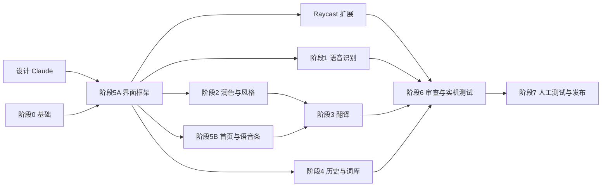

# dictum 开发路线

dictum 是一款 macOS 语音输入应用，对标 Typeless，基于 [TypeWhisper](https://github.com/TypeWhisper/typewhisper-mac)（GPL-3.0）的 fork 开发。仓库：[schneidervvv/dictum](https://github.com/schneidervvv/dictum)。Notion 路线图：[dictum产品路线图](https://app.notion.com/p/00ef0a36adde4420b66feba052f66a00)。

## V0.1.0 完成标准

以下每一项都在本机构建出的 dictum.app 上实际运行通过，并有截图或日志作为证据：

1. 按一下 Fn 开始说一段零散的话，再按一下 Fn 结束，当前输入框得到去掉口头禅、处理过改口、分好段落或列表的文字。
2. 按 Fn + 左 Shift 说中文，当前输入框得到语气贴合当前应用、可以直接发送的英文（目标语言可切换）。
3. 说话过程中，语音条实时显示识别出的文字。
4. 每条听写都存进本机历史，并同步到 iCloud Drive 中的 dictum 文件夹；另一台设备或清空本机数据后可以从云端恢复。
5. 个人词库里的词能纠正识别结果，也能传给润色模型；手动改正一个词后自动学进词库；支持 CSV 导入。
6. 用户能设置全局写作风格（语气、正式程度、表情符号、署名），也能按应用指定风格。
7. 主窗口有首页仪表盘（字数、节省时间、平均 WPM、连续天数、热力图、最近记录），界面按 Claude 的设计稿实现。
8. 本地语音识别默认使用 Qwen3-ASR-1.7B（从 HuggingFace 下载 MLX 版本），也能在设置中选择并配置云端识别；V0.1.0 不用真实密钥测试云端识别。
9. 润色和翻译能接入多家供应商：OpenAI、Anthropic、Gemini、OpenRouter、Groq、DeepSeek、通义千问、Kimi、智谱、硅基流动，以及任意 OpenAI 兼容接口。
10. gpt-6-astra 实机测试全部通过后，交给负责人人工测试。

## 阶段

| 阶段 | 内容 | 开发 | 审查 |
| -- | -- | -- | -- |
| 0 基础 | Xcode 构建与测试基线；用户可见部分改名为 dictum；去掉付费和授权限制；删除 GitHub Actions 文件；关闭指向 TypeWhisper 服务器的更新与账号功能；统一的验证脚本（固定的本机签名，每次只运行一个开发版应用） | gpt-6.1-sol | Claude |
| 设计 | 主窗口、首页仪表盘、语音条、上手引导、设置页的设计规范和 HTML 原型；应用图标 | Claude | 负责人查看 |
| 5A 界面框架 | 颜色、字体、间距等设计规范的代码实现；通用组件；主窗口、侧边栏和底部状态行；通用页的快捷键、声音、应用三部分。其余页面先显示 TypeWhisper 原有界面，由负责该页面的阶段替换 | gpt-6.1-sol | Claude（含视觉比对） |
| 1 语音识别 | 默认引擎设为 Qwen3-ASR-1.7B；比较 bf16 和 8bit 在本机的延迟后定默认精度；词库传给 Qwen3；流式预览刷新更快；云端识别可以选择和配置（不用真实密钥测试）；语音识别页面 | gpt-6-astra（low） | Claude |
| 2 润色与风格 | 默认开启润色；新润色提示词（去口头禅、改口、分段、列表）；润色强度三档；全局风格和按应用风格；国内供应商预设；供应商管理；风格页面、AI 模型页面、通用页的润色强度 | gpt-6-astra（low） | Claude |
| 4 历史与词库 | 云同步默认指向 iCloud Drive 文件夹；历史、词库同步；词库自动学习和 CSV 导入；历史页面、词典页面、通用页的历史与同步 | gpt-6-astra（low） | Claude |
| 5B 首页与语音条 | 首页仪表盘、语音条全部状态（含流式文字）、上手引导、菜单栏 | gpt-6-astra（low） | Claude（含视觉比对） |
| Raycast 扩展 | 基于 TypeWhisper 的 Raycast 扩展做 dictum 扩展：开始和结束听写、搜索和复制历史、添加词典词条；在负责人的 Raycast 里本地安装 | gpt-6-astra（low） | Claude |
| 3 翻译 | Fn + 左 Shift 翻译模式；语音条上切换目标语言；按应用调整译文语气；历史区分听写和翻译；通用页的翻译目标语言 | gpt-6-astra（low） | Claude |
| 6 审查与实机测试 | 全部合入后整体代码审查；gpt-6-astra 在本机逐项验证完成标准 | Claude、gpt-6-astra | Claude |
| 7 人工测试与发布 | 负责人人工测试；修复反馈；打包 dictum 0.1.0 并发布到 GitHub Releases | gpt-6-astra（low） | 负责人 |

每个页面只由一个阶段负责，各阶段在自己的 worktree 中只修改自己负责的文件，所以阶段 1、2、4、5B 可以同时开发。

每个开发阶段的流程：开发代理在独立的 git worktree 中开发，自己构建并运行测试，提交 PR；Claude 审查；有问题就由新的开发代理修复，再审查，最多三轮；通过后合入 `main`，同步更新 Notion。

阶段 0、5A 和阶段 0B 的开发代理是 gpt-6.1-sol；阶段 1、2、4、5B 由 gpt-6-astra（推理强度 low，不使用快速模式）开发；2026-10-23 起 Codex 额度不足，新的开发和修复由 Claude Sonnet 5.5 负责，尚未完成的 gpt-6-astra 任务交接给 Pi 的 DeepSeek 接续；2026-10-24 起，正在运行的 Pi 任务完成后，新的开发和修复交给 Codex 的“永不卡住”路由组（group/never-stuck，推理强度 high，不使用 priority）；某个单元中断时，先在同一对话里用该路由组接续，接续 2 次仍失败后改由 Claude Sonnet 5.5 接续。额度用完后使用重置卡：协调代理通知负责人使用重置卡，负责人确认前的开发由 Claude 接替。审查只由 Claude 负责，由一个与开发代理不同的新 Claude 代理审查，使用 Claude Fable 5.1 或 Claude Opus 5.5。

## 关键决策

* 品牌只改用户能看到的部分：应用名、Bundle ID、URL scheme、App Group、iCloud 容器、钥匙串前缀、图标、界面文字、网址。Swift 模块名和文件夹名（如 `TypeWhisperPluginSDK`）保持不变，方便以后合并上游更新。
* 云端历史用"文件夹同步"方式，默认文件夹放在 iCloud Drive。这种方式不需要付费的苹果开发者账号。TypeWhisper 的 iCloud 容器方式需要付费账号，V0.1.0 不使用。
* V0.1.0 使用本机 ad-hoc 签名构建，不做公证。公证需要付费的苹果开发者账号，放到后续版本。
* 关闭 TypeWhisper 的自动更新、授权、会员账号功能，因为它们都连到 TypeWhisper 的服务器。
* 不使用 GitHub Actions，所有构建和测试在本机运行。
* dictum 是个人项目。只为公开发布或其他用户服务、又拖慢开发的功能可以删除，例如插件市场、App Store 版本、企业管理（MDM）配置、配套设备。
* 能导出或导入的数据（个人词典、文本片段、历史、设置）使用和主流竞品（Typeless、Wispr Flow、Superwhisper 等）一致的文件格式和规范，方便在不同工具之间切换。
* dictum 不包含 Apple Intelligence。
* 保留并发展与 Raycast 的连接：dictum 的本机 API 保持可用，并基于 TypeWhisper 的 Raycast 扩展（MIT 授权）做一个 dictum 扩展，只在负责人自己的 Raycast 里安装使用。
* 子代理连续运行超过 2 小时仍未完成时，协调代理派一个 Opus 子代理查看它卡在哪里并协助。
