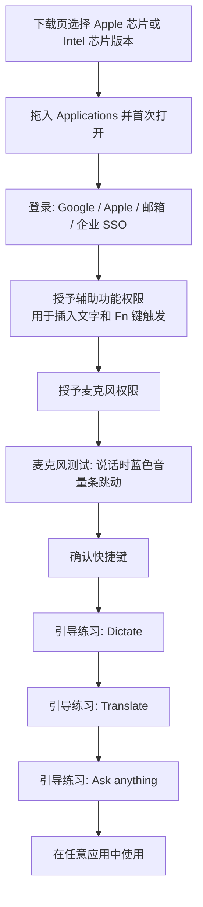
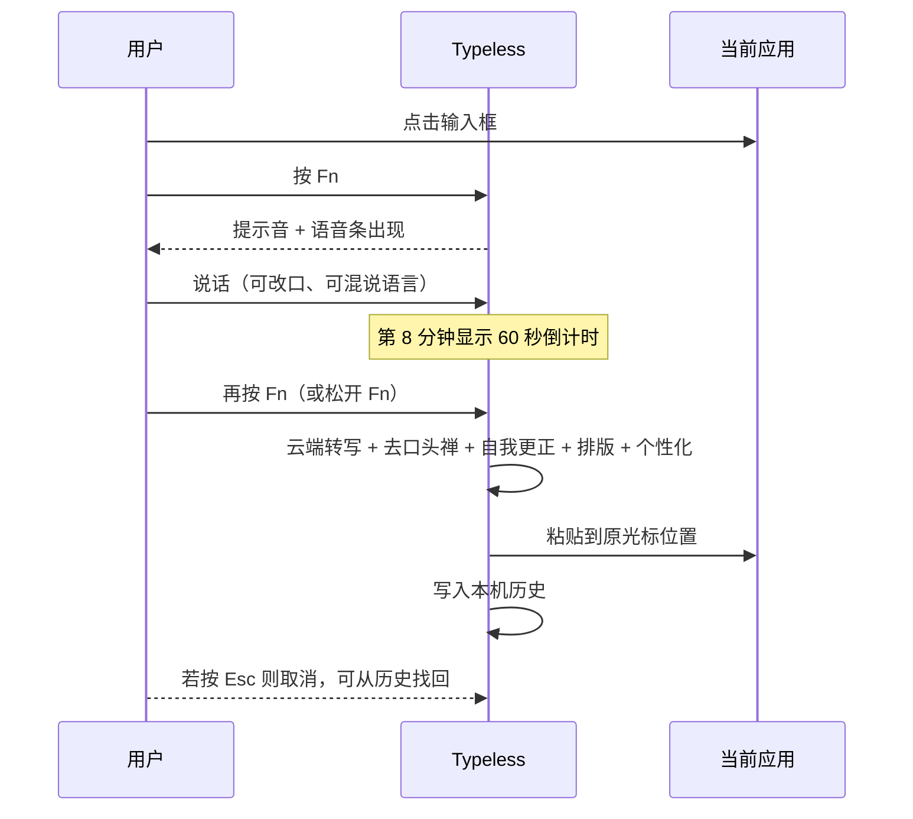

# Typeless 产品调研报告（供 dictum 对标使用）

调研日期：2026-10-22。所有结论都附来源编号，编号对应第 9 节来源列表。标注"推断"的内容是根据资料推理得出，没有官方原文直接说明。

关于一个特殊来源：Typeless 官网的定价页 HTML 中内嵌了一份完整的界面文字包（下文称"官网文字包"，来源 [S20]），里面有网站、团队管理后台和 API 平台的英文界面文字。这份文字包里也混有明显属于其他旧产品的文字（例如 AI 聊天、AI 绘图、浏览器插件、GPT-4o 模型选择），所以本报告只引用和语音输入直接相关的条目，并逐条标注。

---

## 1. 概述

- **定位**：Typeless 是一款 AI 语音输入应用，口号是 "Speak, don't type" 和 "AI Voice Dictation That's Actually Intelligent"。核心卖点是把口语化、啰嗦的话直接变成"像认真打出来的"成稿，并插入到任何应用的光标位置 [S1]。
- **平台**：macOS、Windows、Linux、iOS、Android [S1][S3]。Mac 下载分 Apple 芯片和 Intel 芯片两个版本 [S20]。
- **三大功能块**：Dictate（听写并润色）、Translate（边说边翻译）、Ask anything（用语音编辑选中文字、提问、执行快捷动作）[S1][S4]。
- **发布时间线**：Product Hunt 首发 2025-11-18，iOS 版 2025-12-24，Android 版 2026-01-20 [S29]。官方 YouTube 有 "Meet Typeless 1.0.0 for macOS"、"Meet Typeless 2.0.0"、"Help me write, now live on macOS and Windows"、"Introducing Typeless for Linux" 等视频（只读到标题，视频内容未能读取）[S27]。
- **处理方式**：语音转写在云端完成，需要联网；没有离线模式 [S17][S24][S25]。大模型供应商是 Microsoft 和 Google，签有零保留协议 [S17]。
- **宣传数字**：比打字快 4 倍（键盘 45 WPM 对比 Typeless 220 WPM），每周节省 1 天 [S1]。移动端宣传"比打字快 6 倍" [S20][S22]。

---

## 2. 功能清单

| 功能 | 用户操作 | 效果 | 设置项 | 来源 |
|---|---|---|---|---|
| 听写 Dictate | 光标放在输入框，按一下快捷键（Mac 默认 Fn），说话，再按一下结束 | 润色后的文字插入原光标位置 | 可修改快捷键、可加第二个快捷键 | [S5][S11] |
| 按住说话 Push to talk | 按住 Fn 说话，松开后插入 | 同上 | 同上 | [S6]（该页现已 404） |
| 免手持模式 Hands-free mode | 按 Fn + Space 进入，再按快捷键结束 | 适合长段口述 | 无 | [S6]（与 [S7] 冲突，见 3.2） |
| 取消 Cancel | 录音中按 Esc | 本次结果取消，但可在历史里找回 | 无 | [S6] |
| 去口头禅 Removes filler words | 自动 | 删除 "um""uh""you know" | 无单独开关 | [S1][S20] |
| 去重复 Removes repetition | 自动 | 删除多余和重复的词 | 无 | [S1][S20] |
| 自我更正 Auto-edits when you change your mind | 说话中改口 | 只保留最终意思 | 无 | [S1][S20] |
| 自动排版 Auto-formats | 口述列表、步骤、要点 | 自动变成结构化列表和段落，无需说"换行" | 无 | [S1][S26] |
| 找到更好的措辞 Find the perfect words | 自动 | 让表达更清楚 | 无 | [S1][S20] |
| 个性化风格 Personalized style and tone | 自动学习，无需设置 | 输出越来越像用户本人的写法；首页显示学习进度 | 只有"关闭个性化"一个开关 | [S9] |
| 按应用切换语气 Different tones for each app | 自动 | 邮件更正式，聊天更随意 | 没有找到手动设置界面 | [S1][S20][S28] |
| 上下文感知 Context Awareness | 自动 | 读取屏幕文字、链接、窗口标题，让格式和措辞贴合当前应用 | 企业管理员可整体关闭 | [S20] |
| 个人词典 Personal dictionary | 手动添加、CSV 导入、改字后自动学习 | 名字和术语识别正确 | 筛选：全部、自动添加、手动添加 | [S10][S20] |
| 100+ 语言 | 直接说，可中英混说 | 自动识别语言 | 可选语言地区变体（英、中、西、法、葡） | [S1][S5] |
| 边说边翻译 Translate | 按 Fn + 左 Shift，选目标语言，说母语，按 Fn 结束 | 插入可直接发送的译文 | 翻译目标语言列表，可拖动排序 | [S7] |
| 语音编辑选中文字 Edit selected text | 选中文字，按 Fn + Space，说指令，按 Fn 结束 | 改写结果替换选中内容 | 无 | [S8] |
| 询问选中文字 Ask about selected text | 选中只读文字，按 Fn + Space 提问 | 原文不变，答案显示在弹出卡片 | 无 | [S8] |
| 快速问答 Quick answers | 不选文字，按 Fn + Space 提问 | 可联网搜索，答案在弹出卡片 | 无 | [S8] |
| 快速动作 Quick actions | 说"找视频""找商品""附近地点"等 | 打开对应网站并填好搜索词 | 无 | [S8] |
| 帮我写 Help me write | 给出简单指令 | 生成一段文字 | 未知 | [S22][S27] |
| 耳语模式 Whisper mode | 小声说话 | 在开放办公室等场合也能用（宣传说法） | 未找到官方说明 | [S3][S23] |
| 历史 History | 打开 History 页 | 查看、复制、重试、下载音频、删除、反馈 | 保留时长：永久、1 年、1 月、1 周、24 小时、从不 | [S10] |
| 云同步 Cloud Sync | 手动开启（Pro） | 历史文字加密同步到多设备；关闭时删除云端数据 | 开关 | [S3][S17][S20] |
| 首页数据 Home | 打开应用首页 | 个性化进度卡片；移动端有活跃天数、连续天数、热力图 | 无 | [S9][S22][S30] |
| 团队用量统计 | 管理员后台 | 总听写时长、听写字数、节省时间、平均速度 WPM | 时间范围 7 天、30 天 | [S20] |
| 反馈 Feedback | 首页或历史页 | 对单条结果或整体提交意见 | 无 | [S10][S15] |
| 音频设置 | 设置页 | 选麦克风、测试、提示音、录音时静音其他声音 | 见 3.16 | [S11] |
| 通用设置 | 设置页 | 外观、开机启动、Dock 图标、界面语言（58 种） | 见 3.16 | [S11] |

---

## 3. 每个功能的详细说明

### 3.1 听写 Dictate 与激活方式

- **官方当前步骤（桌面）**：点击要输入的文本框；按一下 Dictate 快捷键（macOS 默认 Fn，Windows 默认右 Alt）；等到提示音或 Voice bar（语音条）出现后说话；再按一下快捷键结束，润色文字出现在开始的位置 [S5]。官网首页步骤图注明 "default: fn on Mac, Right Alt on Windows and Linux" [S20]。
- **按住说话**：旧版上手教程 "first dictation" 写的是按住快捷键（Mac 默认 fn）说话，松开后把格式化好的文字粘贴到光标处 [S6]。这个页面现在返回 404，内容来自搜索引擎摘要，无法确认是否仍有效。
- **推断**：两份文档并存说明 Fn 同时支持"按一下开始、再按一下结束"和"按住说话、松开结束"两种方式。官方没有写明如何区分，常见做法是按住超过一定时间算"按住模式"，短按算"切换模式"。
- **移动端**：点 Typeless 键盘上的 Speak 按钮开始，再点一次结束 [S5]。
- **单次时长上限**：每次最长 9 分钟；到第 8 分钟时，语音条上出现 60 秒倒计时；到达上限后自动把已说内容保存到历史 [S12]。有第三方评测提到早期上限是 6 分钟 [S30]。
- **权限**：需要辅助功能权限（把文字插入任意输入框，并让 Fn 键能触发听写）和麦克风权限 [S4][S13]。
- **Fn 键冲突**：如果 Fn 或自选按键在系统里绑定了其他动作，需要到 系统设置 > 键盘 里关闭或改掉 [S14]。官方没有点名具体冲突项（推断：最常见的是 macOS 的"按下 Fn 键时：显示表情符号 / 开始听写"选项）。

### 3.2 免手持模式 Hands-free mode

- 旧版教程写：长段口述时按 fn + space 进入免手持模式，Typeless 会一直听，直到再次按快捷键结束，然后插入全文 [S6]。
- **冲突**：当前 Ask anything 教程把 Fn + Space 定义为 Ask anything 的默认快捷键 [S8]。所以免手持模式的当前快捷键无法确认。推断：当前版本用"短按 Fn 开始、再按 Fn 结束"的切换方式代替了单独的免手持快捷键。

### 3.3 语音条 Voice bar（浮动指示器）

- 开始听写后出现 Voice bar，并伴有提示音 [S5]。
- 翻译模式下，语音条上可以直接选择目标语言 [S7]。
- 第 8 分钟时语音条上显示 60 秒倒计时 [S12]。
- 安装引导中的麦克风测试显示蓝色音量条，说话时会跳动 [S4][S11]。
- 语音条的具体外观、动画、位置：没有找到官方文字说明或可读的截图描述。

### 3.4 去口头禅、去重复、自我更正、找到更好的措辞

- 官网原文：去口头禅 "Automatically removes filler words like um, uh, you know"；去重复 "Automatically detects and removes unnecessary and repeated words in your speech"；自我更正 "Typeless recognizes when you correct yourself mid-sentence and keeps only your final intended message"；措辞 "Typeless lets you effortlessly express ideas, ensuring your message is easy to understand" [S1][S20]。
- 2.0.0 版本说明强调"更好地处理更正和修改" [S22]。
- 用户抱怨：改写过度、擅自添加内容、格式怪异 [S22]。这说明润色力度需要可控。

### 3.5 自动排版 Auto-formats

- 自动把口述的列表、步骤、要点整理成结构化文字 [S1]。
- 官方博客：口述列表会变成项目符号，段落自动划分，不需要说"new line" [S26]。
- 结合上下文感知，邮件会更正式、Slack 消息更随意 [S26]。

### 3.6 个性化风格 Personalized style and tone

- 无需设置，越用越像本人（正式或随意、简洁或详细）[S9]。
- 首页 Home 上有 Personalization 卡片显示进度，点 "View report" 查看详细报告（页面有一张标题为 "Personalization progress report" 的图）[S9]。
- 隐私说法：只学习抽象模式，不存储内容；原文比喻 "Think of it like recognizing your handwriting without ever reading the words" [S9]。
- 设置：设置 > Personalization，在 "Overall personalization" 区域右上角的 ••• 菜单中可以关闭个性化。关闭后停止学习，使用非个性化措辞 [S9]。
- 用户需求：多位 Product Hunt 评论者希望能按应用设置输出风格（聊天随意、工作正式、Figma 里多用列表）[S29]。

### 3.7 按应用切换语气 Different tones for each app 与上下文感知 Context Awareness

- 根据当前应用调整语气，"from work emails to casual chats" [S1][S20]。
- 管理后台有 "Context Awareness" 开关，原文："When this is on, Typeless reads the context members are typing in so dictation can match its format and wording." 关闭时的确认文字："Typeless will stop reading text on screen, links, and window titles for everyone in this organization. Dictation will still work, but formatting and wording will match the current app less closely." [S20]
- 隐私政策：处理音频时附带"有限的上下文信息"，包括正在使用的应用和附近的文字 [S18]；数据控制页写明上下文包括活动应用和附近文字 [S17]。
- 个人用户是否有该开关：没有找到说明。

### 3.8 个人词典 Personal dictionary

- 用途：人名、项目缩写、领域术语、行业黑话 [S10]。
- 自动学习：听写后手动改正某个词，Typeless 会学习用户偏好的拼写，并放入 "Auto-added" [S10]。iOS 2.8.0 起，用滑行输入改正的词也会自动加入词典 [S22]。
- 手动添加：桌面点 "New word"，输入后点 "Add word" [S10]。
- 批量导入：New word > Import CSV；要求单列 CSV、每行一个词；文件最大 5 MB；一次最多导入 3000 个词 [S10][S20]。
- 容量：词典上限 3000 个词，提示 "This dictionary has reached the limit of 3000 words."（这条出自团队共享词典界面文字，个人词典是否同样上限属于推断）[S20]。
- 管理：右上角搜索；悬停显示 Edit 和 Delete；iOS 2.9.0 支持多选批量删除 [S10][S22]。
- 团队共享词典：管理员创建，成员默认订阅且不能退订；空状态文字："Add names, acronyms, company terms, or industry-specific words. They'll be shared across your team so Typeless gets them right for everyone." [S20]

### 3.9 多语言 100+ languages

- 自动检测语言，支持一句话里混说多种语言 [S1]。
- 可为英语、中文、西班牙语、法语、葡萄牙语选择地区变体：设置 > Language > "Select language variants" [S5]。
- 界面语言 58 种 [S11]。

### 3.10 边说边翻译 Translate

- 目标：把语音变成"像当地人写的"、可直接发送的消息、邮件或帖子 [S1][S7]。
- 设置目标语言：设置 > Language > Translation targets 旁的编辑图标，添加语言，拖动排序 [S7]。
- 桌面步骤：点击输入框；按 Translate 快捷键（macOS 默认 Fn + 左 Shift，Windows 默认右 Alt + 右 Shift）；语音条出现后在当前语言选项里选目标语言；用自己的语言说；按主快捷键 Fn 结束；译文出现在原位置 [S7]。
- 移动端：按住 Speak 上滑选择目标语言 [S7]。iOS 2.0.0 起可以在键盘上切换目标语言 [S22]。
- 免费版包含翻译 [S3]。

### 3.11 Ask anything（语音编辑与问答，仅桌面）

- 快捷键：macOS 默认 Fn + Space，Windows 默认右 Alt + Space；结束都按主快捷键 [S8]。
- 四种用法 [S8]：
  - 编辑选中文字：选中后说出修改要求（语气、格式、细节），结果替换选中内容。
  - 询问选中文字：原文保持不变，答案供查看。
  - 快速问答：可联网搜索，答案显示在弹出卡片。
  - 快速动作：说出动作，例如找视频、商品、附近地点，对应网站打开并填好搜索内容。
- 官网文案示例：改写得更短、更长、更温和、更正式；把笔记改成推文、说明文字或 LinkedIn 帖子；可对 Google、YouTube、Amazon、GitHub 语音搜索 [S20]。
- 官网把它和传统 AI 流程对比："4 steps"（选中、按快捷键、说指令、结果原地出现）对比 "8 steps"（复制、切换标签页、粘贴、输入、等待、复制、切回、粘贴）[S20]。
- 历史页可以按 "Ask anything" 筛选 [S10]。
- 移动端对应功能叫 Speak to edit：选中文字，点左下角 "Speak to edit" 按钮，说出修改要求，再点一次完成 [S16]。

### 3.12 帮我写 Help me write

- iOS 2.7.0（9 月 22 日）加入：根据简单指令生成文字 [S22]。官方视频标题显示该功能已上线 macOS 和 Windows [S27]。具体操作方式没有读到。

### 3.13 耳语模式 Whisper mode

- 定价页把 Whisper mode 列为免费版功能 [S3][S20]。
- App Store 描述提到在走路、通勤或"在别人旁边小声说话"时也能使用 [S22]。第三方评测说它用于开放办公室或火车上小声口述 [S23]。
- 没有找到官方开启方法或设置项。推断：它是对低音量语音的识别优化，不需要用户手动切换。

### 3.14 历史 History

- 记录听写和 Ask anything 的提问；桌面可筛选 All、Dictations、Ask anything [S10]。
- 单条操作：Copy（悬停显示图标）、Feedback（可打字或口述建议，再点 "Send feedback"）、Retry（用同一段音频重新处理）、Download audio、Delete transcript；右上角 More 菜单可 "Delete all" [S10]。另有旗帜图标用于举报某次转写问题 [S15]。
- 保留时长 "Keep history"：Forever、1 year、1 month、1 week、24 hours、Never [S10]。
- 存储：默认只在本机 [S10][S17]。注意：History 页说"历史无法在其他设备访问"，这是关闭云同步时的情况 [S10]。
- 找回：取消或误关结果卡片后可以在历史里找到 [S6][S19]。
- 音频保存：本机历史可以下载音频（推断：音频保存在本机），云端不保存音频 [S10][S17]。

### 3.15 云同步 Cloud Sync

- Pro 功能 [S3]。iOS 2.5.0（8 月 26 日）加入历史跨设备同步 [S22]。
- 默认关闭，用户主动开启；关闭时删除云端的历史文字 [S17]。
- 宣传："Your History is encrypted and accessible only to you." 云端不存音频 [S20]。
- 企业管理员可以禁止成员使用云同步，禁止时删除所有成员的云端历史，本机历史保留 [S20]。
- 企业管理员可以把历史保留上限设为 1 年 [S20]。

### 3.16 设置 Settings（桌面）

入口：应用左下角设置图标 [S11]。

- **键盘快捷键**：Dictate、Translate、Ask anything 三项；点击当前快捷键后按新组合即可修改；"Add another" 可为外接键盘再加一个快捷键；可删除额外快捷键 [S11]。
- **音频**：麦克风 "Auto-detect" 或指定设备；麦克风测试（音量条变蓝表示正常）；Interaction sounds 开关（开始和结束时播放提示音）；Mute when dictating 开关（听写时暂停其他音频）[S11]。
- **语言**：界面语言 58 种；语言地区变体；翻译目标语言 [S5][S7][S11]。
- **个性化**：关闭个性化 [S9]。
- **通用**：Appearance（Light、Dark、System）；Launch app at login；Show app in dock（仅 macOS）[S11]。
- 各项默认值：官方没有写明。

### 3.17 首页 Home 与数据统计

- 桌面首页有 Personalization 卡片和 "View report" [S9]，以及 "Give feedback" 区域 [S15]，左侧边栏有 "Upgrade" 按钮 [S3]。
- iOS 2.6.0（9 月 1 日）重新设计首页，加入使用洞察和热力图 [S22]；第三方摘录的版本说明原文提到活跃天数（active days）、连续天数（streaks）和按天、按周的听写活动热力图 [S30]。
- Product Hunt 用户提到个人统计里能看到听写字数和预计节省时间；一位用户 19 天说了 21,000 多字，平均约 158 WPM，估算节省近 10 小时 [S29]。
- 团队后台统计卡片（官方界面文字）："Total dictation time""Words dictated""Time saved""Average dictation speed"（单位 WPM）；成员活动表列出每人听写时长、字数、节省时间、最近活动 [S20]。推断：个人首页使用同一套指标。
- 官网对"节省时间"的估算口径："Based on a 30-word prompt at 150 wpm spoken / 40 wpm typed." [S20] 推断：节省时间按"字数 ÷ 打字速度 减去 实际说话时长"计算。

### 3.18 反馈 Feedback

- 首页 "Give feedback"：可选最近一条或任意历史结果描述问题，也可关闭结果框后提交整体意见 [S15]。
- 历史页旗帜图标：说明"你说了什么、你期望什么" [S15]。

### 3.19 团队与企业功能

- Pro：成员管理、集中账单、团队用量统计 [S3]。
- Enterprise：SSO、SCIM、域名验证、审计日志、HIPAA 控制和 BAA、批量折扣、灵活开票 [S3]。
- 管理后台可设置：审计日志保留、历史保留上限、是否允许云同步、上下文感知开关、签署 BAA [S20]。

### 3.20 API 平台（推断存在）

- 官网文字包里有 "Typeless API platform" 的界面：API 密钥管理、按请求计费、用量图表、请求日志（字段包括检测到的语言、首个字出现时间 Time to first token、处理时长）[S20]。没有找到公开的 API 文档页面，所以只能推断该平台存在或正在开发。

### 3.21 移动端补充（与 dictum 无直接关系，供参考）

- iOS 键盘：滑行输入 Swipe-to-type（36 种键盘语言）、关闭键盘后继续听写、听写、翻译、语音编辑都有取消按钮 [S22]。
- 用户反馈：Typeless 键盘占用了 iPhone 的表情键 [S29]。

---

## 4. 教程与上手流程

### 4.1 macOS 安装与引导 [S4]

- 下载页有芯片判断说明："Go to Apple menu > About This Mac. Look for Chip or Processor." [S20]
- 被好友邀请下载时显示 "You've got $5 credit for Typeless Pro from your friend's invite." [S20]
- 权限弹窗失败时，引导用户到 系统设置 > 隐私与安全性 手动打开 [S4][S13]。

### 4.2 一次听写的完整流程（根据 [S5][S6][S12] 整理）

### 4.3 官方教程目录

- Quickstart：Dictate、Translate、Ask anything、Speak to edit（移动端）、Personalization、History & Dictionary、Settings [S2]。
- Troubleshooting：转写去哪了、能说多久、权限问题、系统设置冲突、反馈、检查更新、麦克风不可用 [S19]。
- 官方视频（只读到标题）：Introducing Typeless、Meet Typeless 1.0.0 for macOS、Meet Typeless 2.0.0、Typeless Beyond Dictation（AI 语音指令）、Help me write、Typeless for Linux [S27]。

---

## 5. 定价与限制

| 项目 | Free | Pro | Enterprise |
|---|---|---|---|
| 价格 | $0 | 年付每人每月 $12（$144/年）；月付每人每月 $30 | 联系销售 |
| 字数 | 每周有限额（官网只写 "Limited words"） | 无限 | 无限 |
| 准确度 | 标准 | 增强 | 增强 |
| 高峰期 | 标准排队 | 优先 | 优先 |
| 功能 | 听写润色、翻译、Ask anything、个性化、个人词典、100+ 语言、按应用语气、耳语模式 | 加云同步、团队管理、集中账单、团队用量统计 | 加 SSO、SCIM、审计日志、HIPAA/BAA 等 |

来源：[S3]。

- **免费字数的变化**：多个第三方来源记录免费版为每周 8,000 字 [S23][S24][S25][S26]；Voibe 记录应用内通知写着 2026-09-22 起 "Free changes from 8,000 to 2,000 words/week"，并在 2026-10-15 核对官网只显示 "Limited words" [S21]。官网文字包里的竞品对比表写着 "3-day Pro trial for new users" 和 "2,000 free words/week across all platforms" [S20]。结论：当前免费额度很可能是每周 2,000 字，新用户有 3 天 Pro 试用；这两点来自对比表文字，官网定价正文没有直接写明。
- **试用期说法不一致**：官方博客写 "Try Typeless free for a week" [S26]；Spokenly 写 30 天 Pro 试用 [S24]；官网文字包写 3 天 [S20]。推断：试用政策多次调整。
- **App Store 内购价**：$143.99、$60.00、$30.00，周期未标明 [S22]。
- **其他限制**：单次听写 9 分钟 [S12]；词典 3000 词、CSV 一次 3000 词、文件 5 MB [S20]；必须联网 [S26]。
- **取消订阅**：应用内 Account 页的 Subscription 区域 [S3]。
- **推广计划**：推荐好友得 $5 额度、联盟分成、学生计划、礼品卡 [S1][S20]。

---

## 6. 值得借鉴的 UX 细节

- **一个键搞定**：默认 Fn 单键，三个功能共用"按主键结束"的规则（翻译用 Fn + Shift 开始、Ask anything 用 Fn + Space 开始，都按 Fn 结束）[S7][S8]。用户只需记住一个"结束键"。
- **外接键盘第二快捷键**："Add another" 允许为外接键盘单独设置快捷键 [S11]。外接键盘常没有 Fn 键，这个细节很实用。
- **长录音倒计时**：第 8 分钟在语音条上显示 60 秒倒计时，到时自动保存到历史，不丢内容 [S12]。
- **取消可找回**：Esc 取消后结果仍在历史里 [S6]；历史支持用同一段音频 Retry [S10]。
- **语音条里直接切换翻译语言** [S7]。
- **提示音和录音时静音其他声音**都可以单独开关 [S11]。
- **个性化进度可视化**：首页卡片加 "View report"，让用户看到"越用越懂我" [S9]。
- **改字即学习**：用户改正一个词，它自动进入 "Auto-added"；手动添加的单独分组 [S10]。
- **历史保留时长六档**，包括 "Never"（完全不留）[S10]。
- **隐私表达方式**：用 "On device" 和 "Cloud Sync" 两个标签页分别说明隐私承诺 [S1][S20]；比喻 "recognizing your handwriting without ever reading the words" [S9]。
- **空状态文案示例**（团队词典）："No words yet. Add names, acronyms, company terms, or industry-specific words..."；搜索无结果："No words found matching your search." [S20]
- **危险操作确认文案**：删除词条 "'{{term}}' will be deleted forever. This can't be undone." [S20]
- **统计图表空状态**："No data for this period" [S20]。
- **芯片选择弹窗**：下载时教用户判断 Apple 芯片还是 Intel 芯片 [S20]。
- **用户抱怨（需要避免）**：润色过度、擅自加内容 [S22]；长录音提前结束 [S22]；希望有更多个性化设置和按应用风格 [S29]；权限要求过多引发隐私担忧（含屏幕录制等，来自竞品文章，需谨慎看待）[S25]。

---

## 7. 对 dictum V0.1.0 和后续版本的建议

### 7.1 V0.1.0 必须项与 Typeless 功能对应

| dictum V0.1.0 要求 | 对应的 Typeless 功能 | 建议做法 |
|---|---|---|
| (1) 听写加 AI 润色与排版 | Dictate、去口头禅、去重复、自我更正、自动排版、找到更好的措辞 | 全部做；提供"润色强度"选项，回应用户对过度改写的抱怨 [S22] |
| (1) 激活方式 | Fn 单键、按一下切换、按住说话、Esc 取消、外接键盘第二快捷键 | 全部做；明确区分短按和长按 |
| (1) 浮动指示器 | Voice bar、提示音、长录音倒计时 | 全部做 |
| (2) 边说边翻译 | Translate、目标语言列表、语音条上切换语言 | 全部做 |
| (3) 流式预览 | Typeless 没有公开资料说明录音时显示实时文字 | dictum 可在语音条上实时显示识别文字，这一点可以超过 Typeless（推断：Typeless 是松开后才插入）[S5][S6] |
| (4) 本地与云端历史 | History、Keep history 六档、Retry、下载音频、Cloud Sync | 全部做；云端只存文字不存音频，关闭同步即删除云端数据 |
| (5) 个人词典 | 手动添加、自动学习、CSV 导入、搜索、批量删除 | 全部做 |
| (6) 个性化风格与语气 | 个性化学习、按应用语气、上下文感知 | 全部做；同时提供 Typeless 用户想要但缺失的"按应用手动指定风格" [S29] |
| (7) 首页仪表盘 | 字数、节省时间、平均 WPM、听写时长、连续天数、热力图、个性化进度 | 全部做 |
| 设置 | 麦克风选择与测试、提示音、录音时静音、外观、开机启动、Dock 图标、界面语言 | 全部做 |
| 上手引导 | 权限引导、麦克风测试、三项功能练习 | 只练习 V0.1.0 包含的功能（听写、翻译） |

### 7.2 后续版本

| Typeless 功能 | 建议版本 | 理由 |
|---|---|---|
| Ask anything：语音编辑选中文字 | 后续（建议 V0.2） | 技术上复用润色链路，价值高 |
| Ask anything：询问选中文字、快速问答、快速动作 | 后续 | 需要弹出卡片和联网搜索 |
| Help me write | 后续 | 依赖 Ask anything 的指令框架 |
| 耳语模式 | 后续 | 依赖识别模型对低音量的处理 |
| 团队管理、共享词典、团队统计、SSO 等 | 后续 | 面向企业 |
| 反馈与旗帜举报 | 后续（可简化进 V0.1.0 历史页） | 用于改进效果 |
| 语言地区变体 | 后续（中文简繁、英式美式可早做） | 对中文用户有价值 |
| 推荐、礼品卡、联盟 | 后续 | 商业运营 |
| API 平台 | 后续 | 非核心 |
| 移动端键盘 | 后续 | dictum 先做 macOS |

---

## 8. 无法读取的页面列表

- https://www.typeless.com/help/quickstart/first-dictation ：返回 404。本报告中关于"按住 fn 说话""fn + space 免手持""Esc 取消"的内容来自搜索引擎摘要，无法打开原页核对。
- https://www.typeless.com/help/release-notes/macos ：页面能打开，但只显示标题和简介，没有任何版本条目（推断：条目由脚本动态加载）。Windows、Linux、iOS、Android 的发布说明页未逐一打开，索引页同样没有条目。
- https://www.typeless.com/help/troubleshooting/check-for-updates ：未读取（时间限制）。
- 官方 YouTube 频道 https://www.youtube.com/@typelessdotcom 及其视频：只取得视频标题，视频内容和简介都无法读取。
- 官方 X 账号 https://x.com/typelessdotcom ：未读取（需要登录）。
- https://hunted.space/product/typeless-2 ：页面显示 "No data available"，没有产品内容。
- https://www.producthunt.com/products/typeless-2 ：能读取，但没有找到创始团队首发评论的正文。
- Typeless 应用本身的界面（首页、设置、语音条外观）：需要下载登录，本次调研没有安装应用。
- Chrome 网上应用店：没有找到 Typeless 语音输入的官方插件页面（官网文字包里的浏览器插件文字疑似旧产品遗留）。

---

## 9. 来源列表

- [S1] Typeless 官网首页 https://www.typeless.com/
- [S2] 帮助中心 Quickstart 目录 https://www.typeless.com/help/quickstart
- [S3] 定价页 https://www.typeless.com/pricing
- [S4] 安装与设置 https://www.typeless.com/help/installation-and-setup
- [S5] Dictate 教程 https://www.typeless.com/help/quickstart/dictate
- [S6] First dictation 教程（现为 404，内容来自搜索摘要）https://www.typeless.com/help/quickstart/first-dictation
- [S7] Translate 教程 https://www.typeless.com/help/quickstart/translate
- [S8] Ask anything 教程 https://www.typeless.com/help/quickstart/ask-anything
- [S9] Personalization 教程 https://www.typeless.com/help/quickstart/personalization
- [S10] History & Dictionary 教程 https://www.typeless.com/help/quickstart/history-and-dictionary
- [S11] Settings 教程 https://www.typeless.com/help/quickstart/settings
- [S12] 单次听写时长 https://www.typeless.com/help/troubleshooting/dictation-limit
- [S13] 权限问题 https://www.typeless.com/help/troubleshooting/permission-issues
- [S14] 系统设置冲突 https://www.typeless.com/help/troubleshooting/system-setting-conflicts
- [S15] 提交反馈 https://www.typeless.com/help/troubleshooting/give-feedback
- [S16] Speak to edit 教程（移动端）https://www.typeless.com/help/quickstart/speak-to-edit
- [S17] 数据控制 https://www.typeless.com/data-controls （2026-10-13 更新）
- [S18] 隐私政策 https://www.typeless.com/privacy （2026-10-13 更新）
- [S19] 转写去哪了 https://www.typeless.com/help/troubleshooting/missing-transcript ；Troubleshooting 目录 https://www.typeless.com/help/troubleshooting
- [S20] 官网定价页 HTML 中内嵌的界面文字包 https://www.typeless.com/pricing （用 curl 下载 HTML 后提取；包含团队后台、API 平台、竞品对比表、下载页、官网功能文案）
- [S21] Voibe：Typeless Pricing（2026-10-15 核对）https://www.getvoibe.com/resources/typeless-pricing/
- [S22] App Store：Typeless: AI Voice Keyboard https://apps.apple.com/app/id6749257650
- [S23] Laura Hera：Typeless Review（2026-09-05 更新）https://www.laurahera.com/typeless-review/
- [S24] Spokenly：Typeless Review（竞品撰写）https://spokenly.app/blog/typeless-review
- [S25] Voibe：Typeless Review（竞品撰写，2026-10-12 更新）https://www.getvoibe.com/resources/typeless-review/
- [S26] Typeless 官方博客：Typeless vs Wispr Flow（2026-08-02）https://www.typeless.com/blog/typeless-vs-wispr-flow
- [S27] Typeless 官方 YouTube 频道（仅视频标题）https://www.youtube.com/@typelessdotcom
- [S28] 使用场景页 https://www.typeless.com/use-cases
- [S29] Product Hunt 产品页与评论 https://www.producthunt.com/products/typeless-2 ；https://www.producthunt.com/products/typeless-2/reviews
- [S30] 搜索引擎对 App Store 2.6.x 版本说明和第三方评测的摘录（首页连续天数、热力图；时长上限 6 分钟的旧说法），原文来自 [S22] 页面和 https://bossai.tech/blog/typeless-review （该评测页未单独打开）
- 其他：帮助中心 Billing https://www.typeless.com/help/billing ；FAQs https://www.typeless.com/help/faqs ；麦克风不可用 https://www.typeless.com/help/troubleshooting/microphone-unavailable ；Manifesto https://www.typeless.com/manifesto
